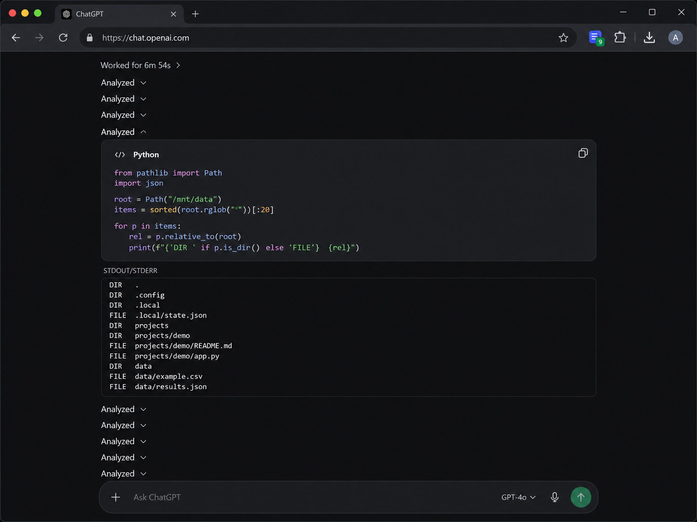
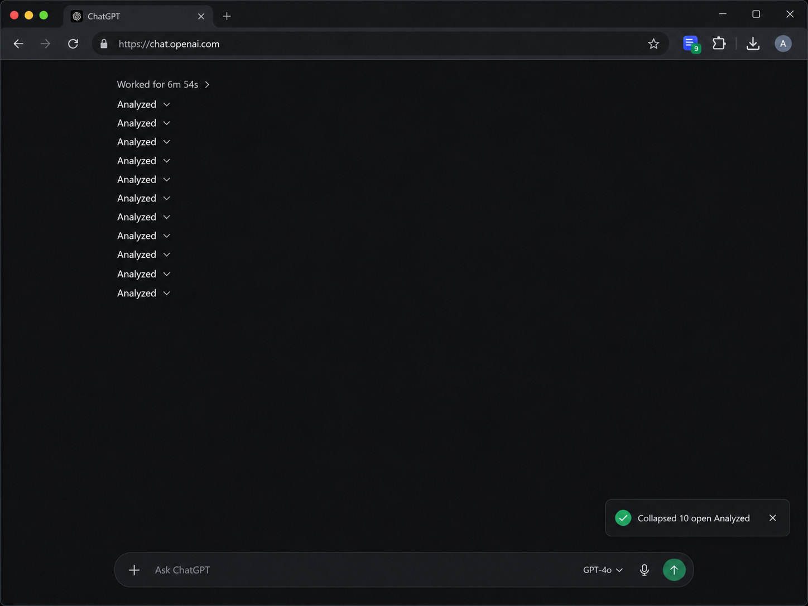
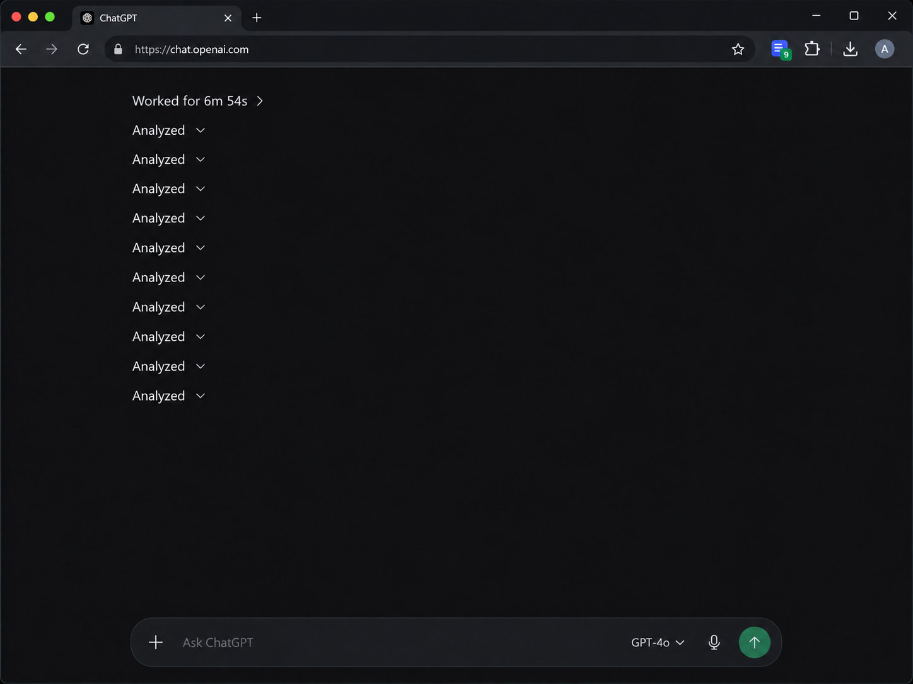

# Collapse Analyzed for ChatGPT & Codex

A lightweight, **one-click Chrome/Chromium extension** for collapsing expanded **Analyzed** sections in supported ChatGPT conversations.

**Current version:** 1.6.0 (public preview)

> Independent community project. Not affiliated with, endorsed by, or sponsored by OpenAI.
> ChatGPT, Codex, and OpenAI are names of their respective owners.

## Screenshots

Below are **illustrative UI mockups** showing the intended before-and-after experience. They are not captures of a live ChatGPT session or proof of compatibility with every ChatGPT interface.

| Before — expanded analysis output | After — one-click collapse |
|:---:|:---:|
|  |  |

**Clean conversation view**



## Features

- **Collapse only:** clicking the toolbar action never intentionally expands a closed section.
- **Fresh scan per click:** detect expanded sections again after you manually reopen them.
- **Large conversations:** batch DOM updates and yield to the browser to reduce UI freezing.
- **Verified counts:** report collapses, already-closed sections, unknown states, and failures.
- **Local processing:** no user account, API key, external server, analytics, or telemetry.
- **Minimal permissions:** `activeTab` and `scripting`, triggered by your click.
- **Keyboard shortcut:** `Alt + Shift + C` (change in `chrome://extensions/shortcuts`).

### Limitations

The extension targets ChatGPT's *Analyzed* panels. A label such as *Analysis paused* may not be recognized. ChatGPT's UI can change; ambiguous panels may be skipped, and some folds are visual CSS changes rather than native ChatGPT state. Refreshing the page resets visual folds. Tests run on simulated ChatGPT-style pages, not guaranteed to match all live ChatGPT or Codex interfaces.

## Installation

### From a GitHub release (recommended)

1. Go to this repository's **Releases** page and download the `collapse-analyzed-for-chatgpt-codex-v1.6.0.zip` release asset.
2. Right-click the ZIP and select **Extract All...**.
3. Open Chrome or Chromium and navigate to `chrome://extensions`.
4. Enable **Developer mode** (top right).
5. Select **Load unpacked** and choose the extracted folder containing `manifest.json`.
6. Open or refresh a ChatGPT conversation, pin the extension, then click its icon.

> Chrome's *Load unpacked* picker cannot install the ZIP itself; extract it first.
>
> A GitHub repository is not the Chrome Web Store. This is a developer-mode installation.

### From source

Download or clone this repository and choose its root folder (which contains `manifest.json`) using **Load unpacked**.

## How it works

The action injects `collapse.js` into the active tab. The script searches for the exact *Analyzed* labels, identifies visible code/STDOUT content, tries recognized native disclosure controls first, and uses a targeted CSS hiding fallback if appropriate. It confirms visible content has disappeared before counting a successful collapse. It avoids final answer prose, charts, images, and tables where possible, and provides a toast and toolbar badge with the result.

**It runs only when you click the extension icon or invoke its shortcut.** There is no always-on content script, background page scraping, or remote synchronization.

## Privacy

The code is intentionally small and readable. The extension requests only:

```json
["activeTab", "scripting"]
```

It does not contain HTTP calls, third-party dependencies, or tracking code. Conversation content is processed in the local browser tab to identify sections. See [PRIVACY.md](PRIVACY.md).

## Development and tests

Requirements: Python 3.10+ and Playwright with Chromium.

```bash
pip install playwright
python -m playwright install chromium
python tests/regression.py
```

The included synthetic regression suite has **39 checks**, covering collapsed/open state, repeat clicks, manual reopening, answer preservation, separate stdout blocks, and a 1,000-section mixed-state page. These results don't certify compatibility or responsiveness on every computer or live ChatGPT page.

To create a release ZIP from this repository:

```bash
python scripts/package_release.py
```

The script creates `dist/collapse-analyzed-for-chatgpt-codex-v1.6.0.zip` with only the installable extension files.

## Reporting issues

Please use GitHub Issues. Include the browser version, OS, extension version, the toast text, and a short reproduction. **Never upload private conversations, authentication cookies, API keys, or unsanitized HTML.**

## License

This project is distributed under the [MIT License](LICENSE). Before publishing a fork, verify that you own or have permission to license all included materials and update the copyright notice if appropriate.

---
**Not an official OpenAI extension.**
